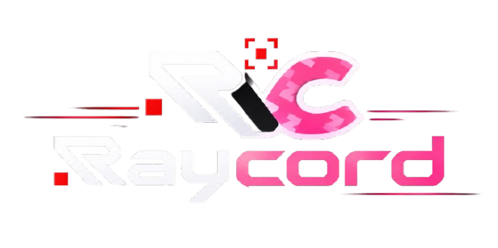

<div align="center">

<picture>
  
</picture>

<p>A Vencord plugin that shows safety flags from Rayward's sources on Discord profiles, in chat and in the member list.</p>

[](https://github.com/theseven1/Rayward-Vencord-User-Plugin/actions/workflows/ci.yml)
[](https://github.com/theseven1/Rayward-Vencord-User-Plugin/releases/latest)
[](LICENSE)
[](https://vencord.dev)

</div>

## What it does

Rayward collects results from several Roblox and Discord safety sources: Rotector, TASE, RAB, Okappiki, ServerSweep, RCR and etc. This plugin looks people up there and shows the answer where you're already looking.

- A Rayward section in profiles and the DM sidebar, with an overview and report.
- Each source's status, reasons, evidence and links.
- Markers next to flagged users in the member list and chat, plus a warning under their message.
- `/rayward`, `/rayward-roblox` and `/rayward-group` slash commands (Only visible to you)

<p>
  
</p>

## Install

Vencord only loads custom plugins from a build you make yourself, so you'll need [Git](https://git-scm.com), [Node.js](https://nodejs.org) 22 or newer and [pnpm](https://pnpm.io).

```sh
git clone https://github.com/Vendicated/Vencord.git
cd Vencord
pnpm install --frozen-lockfile
git clone https://github.com/theseven1/Rayward-Vencord-User-Plugin.git src/userplugins/rayward
pnpm build
pnpm inject
```

`pnpm inject` patches the Discord desktop app. For the browser extension, run `pnpm buildWeb` instead and load `dist/chromium-unpacked`. Vesktop users can point **Settings > Vencord location** at the `dist` folder.

You can also download `rayward-vX.Y.Z.zip` from the [latest release](https://github.com/theseven1/Rayward-Vencord-User-Plugin/releases/latest), unzip it into `src/userplugins/` and build the same way.

Once Discord restarts, open **Settings > Vencord > Plugins**, enable **Rayward** and paste your Rayward API key. You can apply for one at [rayward.app](https://rayward.app/signin).

[docs/installation.md](docs/installation.md) covers updating, uninstalling and common problems.

## Configuration

Profiles are checked when you open them. Member list and chat markers check everyone you can see. Sources can be switched on or off individually. Every setting is listed in [docs/configuration.md](docs/configuration.md).

## Privacy

Looking someone up sends their Discord ID, and the IDs of Roblox accounts linked to them, to Rayward with your API key. Roblox avatars and names come from Roblox's public API. Nothing is sent to the plugin's author. [docs/privacy.md](docs/privacy.md) lists every host the plugin contacts and when.

## Contributing

Bug reports, ideas and pull requests are welcome. [CONTRIBUTING.md](CONTRIBUTING.md) explains the setup, the checks CI runs and how releases work. For how the code fits together, see [docs/architecture.md](docs/architecture.md).

Please report security problems privately, as described in [SECURITY.md](SECURITY.md).

## Credits

<table>
  <tr>
    <td align="center" width="180">
      <a href="https://github.com/theseven1"></a>
      <br><b>MkSeven1</b>
      <br><sub>Author and maintainer</sub>
      <br><sub>Discord: <code>_de.bug</code></sub>
    </td>
    <td align="center" width="180">
      <a href="https://github.com/raywardapp"></a>
      <br><b>Rayward</b>
      <br><sub>Logo and API</sub>
      <br><sub>https://rayward.app</sub>
    </td>
     <td align="center" width="180">
      <a href="https://github.com/Vendicated/Vencord"></a>
      <br><b>Vencord</b>
      <br><sub>Vencord</sub>
      <br><sub>https://vencord.dev/</sub>
    </td>
  </tr>
    
</table>

Results come from [Rayward](https://rayward.app) and the sources it connects: [Rotector](https://rotector.com), [TASE](https://tasebot.org), [RAB](https://simmer.icu/rab), [Okappiki](https://okappiki.com), ServerSweep, [RCR](https://rcr.gg) and [RoLock](https://rolock.dev). Each source runs its own detection and handles its own appeals.

Built on [Vencord](https://github.com/Vendicated/Vencord). Status icons are from [Tabler Icons](https://tabler.io/icons).

## Disclaimer

This is an independent project. It isn't made by or affiliated with Rayward, Discord, Roblox, Vencord or any of the sources, and their names and logos belong to their owners. A flag is a reason to look closer, not proof. To dispute a flag, contact the source that issued it.

## License

[GPL-3.0-or-later](LICENSE), the same license as Vencord.
